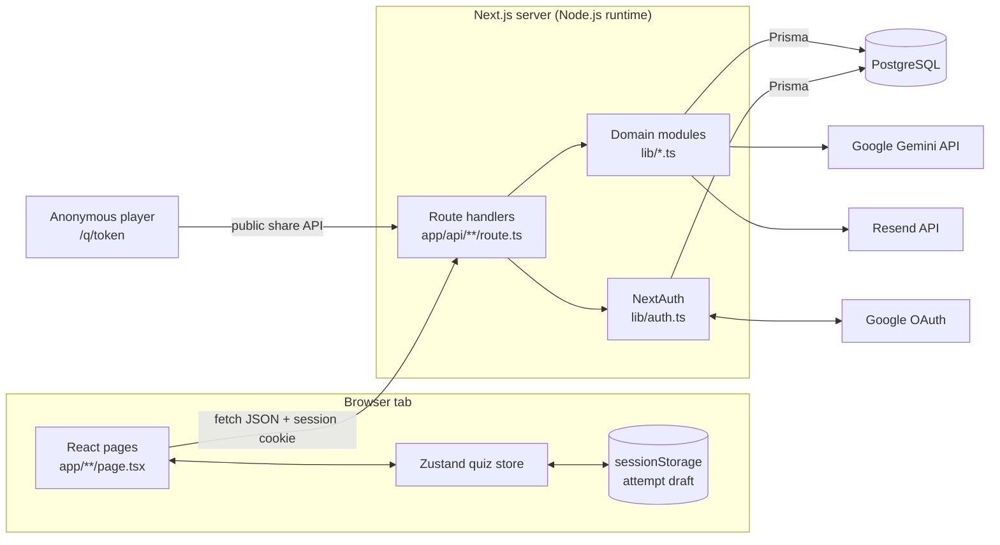

# 01. Overview

[Index](README.md) | [Next: 02. Concepts →](02-CONCEPTS.md)

**Purpose:** explain what QuizForge does, for whom, with what technology, and where to start reading.
**Prerequisites:** none.

## The problem

Students have notes, slides, and textbook chapters. Turning them into practice questions takes time, and re-reading is a weak way to study. QuizForge automates the "make me a practice test" step. You upload a document, choose difficulty and length, and receive a timed multiple-choice quiz drawn from that material. Afterwards it shows what you got wrong, grouped by topic, and brings missed questions back on a schedule.

## Intended users and primary workflows

| User | Primary workflows | Account |
|---|---|---|
| **Learner** | Upload a document → configure → take a practice or exam quiz → review results. Revisit history, retake quizzes, run Cram Mode, do Smart Review, ask the AI follow-up questions, share a quiz. | Required: email/password or Google |
| **Challenge player** | Open a public `/q/<token>` link, enter a display name, answer, see the score, the answer key, and the leaderboard. | Not required |
| **Developer / operator** | Configure environment variables, push the database schema, run, test, and deploy. | Not applicable |

The repository contains no admin interface, no instructor or class features, and no organization-level accounts.

## Implemented features and their boundaries

"Boundary" states what the feature deliberately does **not** do, based on the code.

| Feature | What it does | Boundary | Main code |
|---|---|---|---|
| Document upload | One PDF or DOCX, at most 10 MB. Checks extension, MIME type, and file signature, then extracts plain text. | No scanned-image OCR, no PPTX/TXT, no images or tables as structure. PDFs over 500 pages and text over 2,000,000 characters are rejected. | [`app/api/analyze-document/route.ts`](../app/api/analyze-document/route.ts), [`lib/document-parser.ts`](../lib/document-parser.ts) |
| Document library | Stores extracted text per user. Keeps the 20 newest. Rename, delete, and "new quiz from this document". | The original file is never stored, only its text. | [`app/documents/page.tsx`](../app/documents/page.tsx), [`app/api/documents/`](../app/api/documents/route.ts) |
| AI question generation | Sends up to 50,000 characters to Google Gemini and keeps only questions that pass validation. | No guarantee that questions are correct or answerable from the text. See [07](07-AI-GENERATION.md#grounding-correctness-and-answerability). | [`lib/gemini.ts`](../lib/gemini.ts) |
| Quiz configuration | 5 to 50 questions, 5 to 120 minutes, easy/medium/hard/mixed, practice or exam. | The UI offers fixed time choices; the server accepts any integer in range. | [`components/QuizConfig.tsx`](../components/QuizConfig.tsx), [`lib/constants.ts`](../lib/constants.ts) |
| Practice mode | One question at a time with immediate feedback, explanations, optional confidence rating, and pause. | The browser holds the answer key, so a determined user can read it. | [`components/QuizInterface.tsx`](../components/QuizInterface.tsx) |
| Exam simulation | Free navigation and editable answers, no feedback until submission, no pause. The answer key is encrypted so the browser cannot read it. | Confidence is not collected in exam mode. | [`components/ExamInterface.tsx`](../components/ExamInterface.tsx), [`lib/exam-token.ts`](../lib/exam-token.ts) |
| Timers and auto-submit | Wall-clock deadline that submits automatically, even from another page of the app. | Runs only while a QuizForge tab is open. | [`lib/countdown.ts`](../lib/countdown.ts), [`lib/attempt-deadline.ts`](../lib/attempt-deadline.ts) |
| Refresh recovery | Restores an in-progress attempt after a refresh in the same tab. | Uses `sessionStorage`, so closing the tab or signing out discards it. | [`lib/attempt-recovery.ts`](../lib/attempt-recovery.ts) |
| Server-side grading | Verifies a signed proof of the issued quiz, recomputes every metric, saves at most once per attempt. | Practice attempts expire 15 minutes after the time limit; exams 30 seconds after. | [`app/api/save-quiz/route.ts`](../app/api/save-quiz/route.ts), [`lib/quiz-proof.ts`](../lib/quiz-proof.ts) |
| Results | Score, accuracy, per-topic chart, weak topics (under 60%), revision suggestions. | Suggestions are template sentences, not AI-written. | [`lib/quiz-utils.ts`](../lib/quiz-utils.ts), [`components/ResultsDashboard.tsx`](../components/ResultsDashboard.tsx) |
| History and dashboard | Paginated history, detail pages, averages, streak, topic mastery, confidence calibration. | Dashboard analytics re-read every saved result on each load. | [`app/api/history/route.ts`](../app/api/history/route.ts), [`lib/history-analytics.ts`](../lib/history-analytics.ts) |
| Retake | Re-issues a past quiz with questions and options shuffled. | Older results that fail current validation cannot be retaken. | [`app/api/history/[id]/route.ts`](../app/api/history/%5Bid%5D/route.ts) |
| Cram Mode | 10, 20, or 30 questions from your most-missed questions and weakest topics. | Uses only the 50 most recent results; needs at least 5 candidates. | [`app/api/cram/route.ts`](../app/api/cram/route.ts) |
| Smart Review | Missed questions return after 1, 3, 7, then 21 days; correct at the top rung retires them. | At most 500 items per user; 20 shown per session. | [`lib/review.ts`](../lib/review.ts), [`app/review/page.tsx`](../app/review/page.tsx) |
| Ask the AI | A follow-up question about one quiz item, grounded in an excerpt of your document when available. | Answers are not stored. Limited to 10 per 10 minutes per user per server instance. | [`app/api/explain/route.ts`](../app/api/explain/route.ts) |
| Share links | Public quiz without answers, server grading, top-20 leaderboard, owner revocation. | Players are anonymous; the answer key is returned after any submission. | [`app/api/share/`](../app/api/share/route.ts), [`app/q/[token]/page.tsx`](../app/q/%5Btoken%5D/page.tsx) |
| Accounts | Register, sign in, Google sign-in, change password, reset by email, edit name and study preferences, delete account. | No email verification for credential accounts; no multi-factor authentication. | [`lib/auth.ts`](../lib/auth.ts), [`app/settings/page.tsx`](../app/settings/page.tsx) |

### Incomplete, planned, or absent

- **Uncommitted parser change.** The working tree modifies the Gemini response parser in `lib/gemini.ts` and adds a test and a local benchmark. It is not committed. [07](07-AI-GENERATION.md#committed-vs-working-tree-parser) describes both versions.
- **Plans.** `FEATURES_ROADMAP.md` and `docs/IMPROVEMENT_PLAN.md` may exist locally but are git-ignored. Nothing in them is described here as implemented.
- **Absent:** email verification, multi-factor authentication, admin tools, database migrations history (the schema is applied with `prisma db push`), automated end-to-end tests, CI configuration, and Docker files.

## Technology stack

| Technology | Version (lockfile) | Role in QuizForge |
|---|---|---|
| [Next.js](https://nextjs.org) (App Router) | 16.3.6 | One app for pages (`app/**/page.tsx`) and JSON APIs (`app/api/**/route.ts`). Builds use webpack (`--webpack` flag in [`package.json`](../package.json)). |
| React | 19.2.0 | Interactive pages are client components (`'use client'`) that fetch data from the API. |
| TypeScript | 5.x, `strict: true` | All application code. See [`tsconfig.json`](../tsconfig.json). |
| NextAuth.js | 4.24.15 | Credentials and Google providers, JWT cookie sessions. [`lib/auth.ts`](../lib/auth.ts) |
| Prisma ORM | 6.12.0 | Typed PostgreSQL access. [`prisma/schema.prisma`](../prisma/schema.prisma), [`lib/prisma.ts`](../lib/prisma.ts) |
| PostgreSQL | Not pinned | Stores users, documents, results, review items, share links, reset tokens. |
| Google Generative AI SDK | ^0.21.0 | Calls Gemini (default model `gemini-2.5-flash`). [`lib/gemini.ts`](../lib/gemini.ts) |
| pdf-parse / mammoth | 1.1.x / 1.11.0 | Extract text from PDF and DOCX. mammoth is patched by [`patches/mammoth+1.11.0.patch`](../patches/mammoth+1.11.0.patch). |
| bcryptjs | ^2.4.3 | Password hashing (cost 10). |
| Zustand | 4.5.x | Browser-side quiz attempt state. [`store/quiz-store.ts`](../store/quiz-store.ts) |
| Recharts | 2.15.x | Dashboard and results charts, lazy-loaded. [`components/charts/`](../components/charts/DashboardCharts.tsx) |
| react-dropzone, lucide-react | | Upload drop zone and icons. |
| Tailwind CSS | 3.4.x | Styling. [`tailwind.config.js`](../tailwind.config.js), [`app/globals.css`](../app/globals.css) |
| Resend (HTTP API, no SDK) | | Password-reset email. [`lib/email.ts`](../lib/email.ts) |
| Vitest | 4.1.11 | Unit and integration tests with mocks, Node environment. [`vitest.config.mts`](../vitest.config.mts) |
| ESLint | 9.39.5 | `eslint-config-next` rules. [`eslint.config.mjs`](../eslint.config.mjs) |
| patch-package | 8.0.1 | Applies the mammoth patch on `npm install`. |

## Platform requirements

| Requirement | Detail |
|---|---|
| Node.js | 20.9 or newer. The installed `next` package declares `"node": ">=20.9.0"`. The root README said 18+ until this documentation update corrected it. |
| Database | A reachable PostgreSQL instance (`DATABASE_URL`) |
| AI provider | A Google Gemini API key for generation and Ask the AI |
| Optional services | Google OAuth client (Google sign-in); Resend (reset email; required in production) |
| Browser | A modern browser with JavaScript, cookies, and `sessionStorage`. Refresh recovery degrades gracefully when storage is blocked. |
| Operating system | Any. Nothing in the code is Windows-specific; the guides use PowerShell because that is the documented development environment. |

Full setup: [09. Setup and Configuration](09-SETUP-AND-CONFIGURATION.md).

## High-level system diagram

## Application lifecycle in brief

A web application has no single main loop. The **server** starts with `npm run dev` (development) or `npm start` (after `npm run build`) and then runs one handler call per HTTP request. The **browser** side starts when a page loads. [`app/layout.tsx`](../app/layout.tsx) wraps every page in [`Providers`](../app/providers.tsx), which mounts NextAuth's `SessionProvider` and then [`AttemptRecovery`](../components/AttemptRecovery.tsx). Once the session is known, `AttemptRecovery` restores any in-progress quiz for that user and mounts [`AttemptDeadline`](../components/AttemptDeadline.tsx), which enforces the deadline from any page. On [`/upload`](../app/upload/page.tsx), an attempt moves through four steps: upload → configure → quiz → results. [03. Architecture](03-ARCHITECTURE.md#lifecycle) covers this in depth.

## A short guided tour

Walk through the app with the code open beside it.

1. **Landing page `/`.** [`HeroSection`](../components/HeroSection.tsx) offers a file drop pill. If you are signed out, choosing Generate sends you to `/login` first (`requireAuth`).
2. **Sign in `/login`.** [`app/login/page.tsx`](../app/login/page.tsx) calls `signIn('credentials')`. The server side is `authorize` in [`lib/auth.ts`](../lib/auth.ts).
3. **Upload `/upload`.** [`FileUpload`](../components/FileUpload.tsx) posts the file to `/api/analyze-document`. The extracted text goes into the store and the page shows the configure step.
4. **Configure.** [`QuizConfig`](../components/QuizConfig.tsx) calls `handleStartQuiz` in the upload page, which posts to `/api/generate-questions`. The response contains the questions, the canonical config, a `quizProof`, and `startedAt`.
5. **Take the quiz.** [`QuizInterface`](../components/QuizInterface.tsx) (practice) or [`ExamInterface`](../components/ExamInterface.tsx) (exam). Answers go into the store through `submitAnswer`.
6. **Submit.** `saveQuiz` in the store posts to `/api/save-quiz`. The server grades and returns the saved result. The page shows [`ResultsDashboard`](../components/ResultsDashboard.tsx).
7. **Dashboard `/dashboard`.** Totals, charts, Smart Review entry, and Cram Mode. Data comes from `/api/history?view=dashboard`.
8. **History `/history` and `/history/<id>`.** List, details, retake, and share.
9. **Review `/review`, Documents `/documents`, Settings `/settings`.** Each is a client page backed by its own API routes.

Then read these files in order:

1. [`lib/types.ts`](../lib/types.ts): the shared vocabulary (`Question`, `QuizConfig`, `QuizSession`, `QuizResult`).
2. [`prisma/schema.prisma`](../prisma/schema.prisma): what is stored and who owns it.
3. [`store/quiz-store.ts`](../store/quiz-store.ts): the browser-side attempt state machine.
4. [`lib/quiz-issuance.ts`](../lib/quiz-issuance.ts) and [`lib/quiz-proof.ts`](../lib/quiz-proof.ts): how a quiz is handed out so it cannot be altered.
5. [`app/api/save-quiz/route.ts`](../app/api/save-quiz/route.ts): grading and persistence.
6. [`tests/save-quiz-integrity.test.ts`](../tests/save-quiz-integrity.test.ts): the executable description of those guarantees.

---

[Index](README.md) | [Next: 02. Concepts →](02-CONCEPTS.md)
