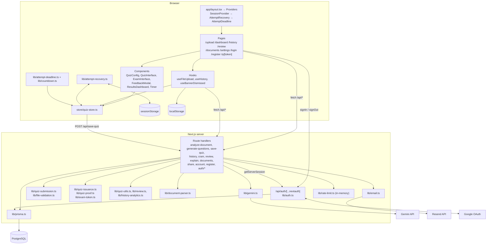
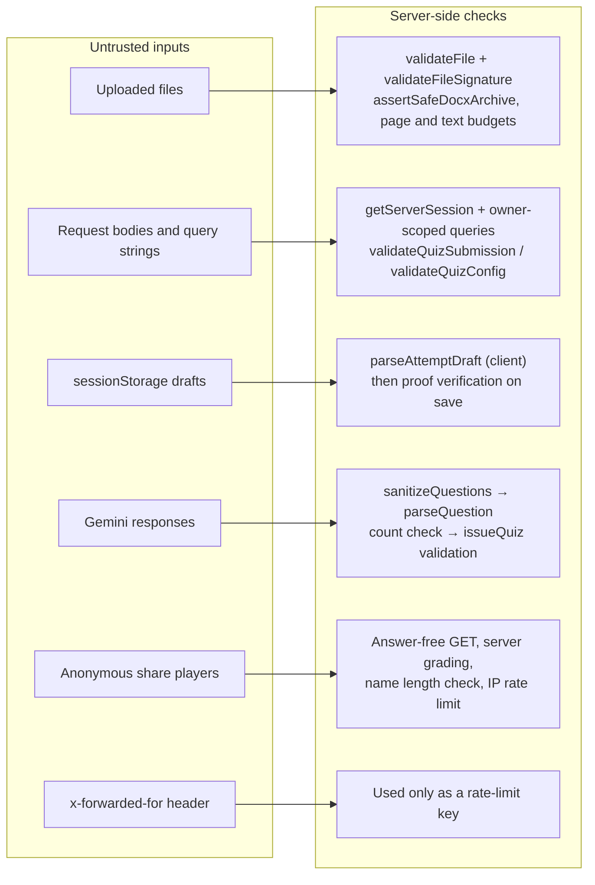
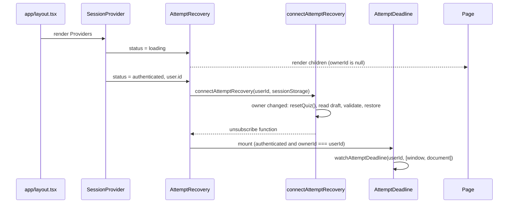
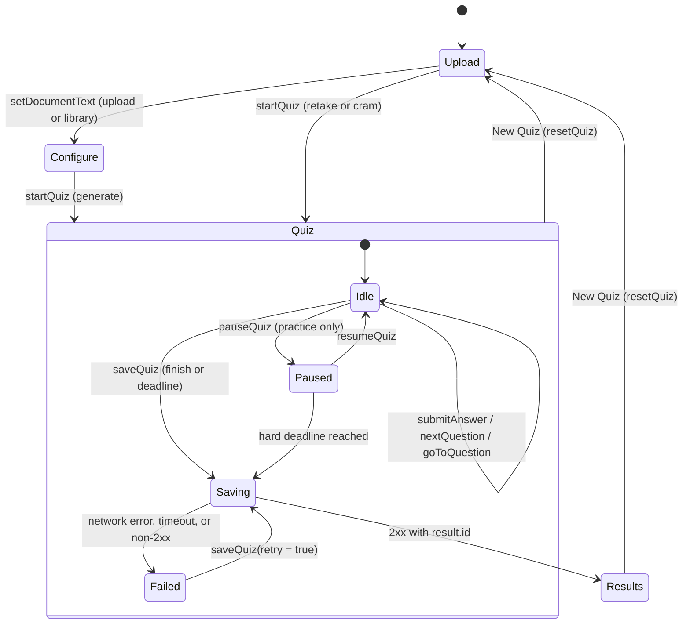

# 03. Architecture

[← 02. Concepts](02-CONCEPTS.md) | [Index](README.md) | [Next: 04. Codebase Guide →](04-CODEBASE-GUIDE.md)

**Purpose:** show how QuizForge is organized, which part owns which responsibility and state, where trust boundaries sit, and which trade-offs the design makes.
**Prerequisites:** [01. Overview](01-OVERVIEW.md). Concepts referenced here are explained in [02](02-CONCEPTS.md).

## Layers

QuizForge is a single Next.js application with four logical layers. The folders map to them closely.

| Layer | Folders | Runs in | Responsibility |
|---|---|---|---|
| **Presentation** | `app/**/page.tsx`, `components/`, `hooks/` | Browser (pre-rendered on server) | Render UI, collect input, call the API, show results |
| **Client state** | `store/quiz-store.ts`, `lib/attempt-recovery.ts`, `lib/attempt-deadline.ts`, `lib/countdown.ts` | Browser | Hold the active attempt, enforce UI-level timing, persist a recovery draft |
| **API** | `app/api/**/route.ts` | Server | Authenticate, authorize, validate input, orchestrate domain modules, shape JSON responses |
| **Domain and integration** | `lib/*.ts` (server modules), `prisma/` | Server | Parsing, AI calls, proofs and encryption, scoring, scheduling, email, database access |

`lib/` holds both server-only and browser-safe modules. Some, such as [`lib/quiz-utils.ts`](../lib/quiz-utils.ts) (`formatTime`, `barColorForPct`) and [`lib/quiz-submission.ts`](../lib/quiz-submission.ts) (`parseQuestion`), are imported on both sides. Modules that use `node:crypto`, Prisma, or secrets are imported only by route handlers.

## Overall architecture

## Module responsibilities

The modules that carry the design, and why each exists:

| Module | Responsibility | Why it is separate |
|---|---|---|
| [`lib/auth.ts`](../lib/auth.ts) | NextAuth configuration: providers, Google account-linking rules, the `jwt` callback that revokes stale sessions | Single source of `authOptions`; every protected handler passes it to `getServerSession` |
| [`lib/session-credentials.ts`](../lib/session-credentials.ts) | Computes and compares the credential stamp | Isolates the hashing so it can be tested and never leaks into the public session object |
| [`lib/auth-security.ts`](../lib/auth-security.ts) | Email normalization, email format check, Google linking rule, production secret check | Pure functions used by auth, register, and forgot-password, unit-tested in isolation |
| [`lib/document-parser.ts`](../lib/document-parser.ts) | PDF/DOCX text extraction with size budgets | Keeps heavy Node-only parsers out of route code; [`next.config.js`](../next.config.js) also excludes them from client bundles |
| [`lib/gemini.ts`](../lib/gemini.ts) | Prompts, model fallback, response parsing and sanitizing, explanation prompts | The only module that talks to the AI provider |
| [`lib/quiz-submission.ts`](../lib/quiz-submission.ts) | Canonical validation of questions, configs, and submissions | One definition of "a valid quiz", shared by issuance, save, recovery, cram, retake, and AI sanitizing |
| [`lib/quiz-issuance.ts`](../lib/quiz-issuance.ts) | `issueQuiz`: validate, sign, and for exams encrypt | The single door through which any quiz reaches a browser: new, retake, or cram |
| [`lib/quiz-proof.ts`](../lib/quiz-proof.ts) | HMAC proof creation and verification with expiry | Lets the server verify a quiz without storing in-progress attempts |
| [`lib/exam-token.ts`](../lib/exam-token.ts) | AES-256-GCM sealing of exam content | Keeps the exam answer key away from the browser |
| [`lib/quiz-utils.ts`](../lib/quiz-utils.ts) | Scoring, topic analysis, suggestions, shuffling, deserialization, formatting | Pure functions shared by server and client |
| [`lib/review.ts`](../lib/review.ts) | Spaced-repetition ladder and question hashing | Scheduling rules in one testable place |
| [`lib/history-analytics.ts`](../lib/history-analytics.ts) | Incremental dashboard aggregation | Lets the history route stream batches instead of loading everything |
| [`lib/rate-limit.ts`](../lib/rate-limit.ts) | Fixed-window in-memory limiter | Shared by all rate-limited routes |
| [`lib/email.ts`](../lib/email.ts) | Resend HTTP call and reset email template, console fallback in development | Keeps the only email path small and swappable |
| [`store/quiz-store.ts`](../store/quiz-store.ts) | Browser attempt state and `saveQuiz` | A single owner for attempt state so pages, the deadline watcher, and recovery agree |
| [`lib/attempt-recovery.ts`](../lib/attempt-recovery.ts) | Persist and restore the attempt draft per account and tab | Isolates untrusted-storage handling from UI code |
| [`lib/attempt-deadline.ts`](../lib/attempt-deadline.ts) | Submit an expired attempt from any route | The quiz page may not be mounted when time runs out |

## How modules communicate

| From → To | Mechanism | Example |
|---|---|---|
| Component → store | Zustand hook and actions | `useQuizStore().submitAnswer('b')` |
| Non-React module → store | `useQuizStore.getState()` / `.subscribe()` | `watchAttemptDeadline` subscribes and calls `saveQuiz` |
| Browser → server | `fetch` with JSON (or `FormData` for upload). The NextAuth session cookie is sent automatically on same-origin requests. | `fetch('/api/generate-questions', { method: 'POST', body: JSON.stringify(...) })` |
| Browser → NextAuth | `signIn`, `signOut`, `useSession`, `getProviders` from `next-auth/react` | [`app/login/page.tsx`](../app/login/page.tsx) |
| Handler → identity | `getServerSession(authOptions)` returns `session.user.id` or null | Every private handler |
| Handler → database | Prisma client singleton | `prisma.quizResult.findMany(...)` |
| Handler → providers | `@google/generative-ai` SDK; `fetch` to Resend | [`lib/gemini.ts`](../lib/gemini.ts), [`lib/email.ts`](../lib/email.ts) |

There are no server actions, no tRPC or GraphQL layer, no message queue, and no WebSocket channel.

## State ownership and persistence

| State | Owner | Lifetime | Trusted by server? |
|---|---|---|---|
| Users, documents, results, review items, share links, entries, reset tokens | PostgreSQL | Until deleted | Yes |
| Session identity (`sub`, `credentialStamp`) | Encrypted NextAuth JWT cookie | Until expiry or revocation | Yes, after decryption and the stamp check against the database |
| In-progress attempt (questions, answers, confidences, timing) | Browser memory (Zustand) | Until saved, reset, or tab closed | No. Only answers are taken from it; questions are verified by proof |
| Quiz proof (`quizProof`) | Browser, issued by server | Until `expiresAt` (still accepted afterwards to retrieve an existing save) | Yes, after HMAC verification |
| Exam token (`exam1.` prefix) | Browser, issued by server | Same | Yes, after AES-GCM decryption with the user id |
| Recovery draft | `sessionStorage` key `quizforge-attempt-v1` | Until tab closes or sign-out | No. Re-validated on load and never sent as-is |
| Banner dismissal | `localStorage` key `features-banner-dismissed` | Indefinite | Not used by server |
| Rate-limit counters | Server process memory | Until process restarts | Server-internal |
| Extracted document text during config | Browser memory (`documentText`) | Until reset | Used only when no `documentId` is sent |

The main idea: **the server keeps no record of an attempt until it is saved.** Instead it signs (and for exams encrypts) the attempt and gives it to the browser to carry. This is a stateless design. [Trade-offs](#observable-trade-offs) discusses what it gains and costs.

## Trust boundaries

Private data boundary: everything owned by a user is reached only through handlers that require a session and scope queries to `session.user.id`. The only unauthenticated data routes are `GET /api/share/[token]`, `POST /api/share/[token]/submit`, `POST /api/register`, and the two password-recovery routes. Details: [08](08-AUTH-SECURITY-AND-RELIABILITY.md).

## Lifecycle

### Server process

1. `npm run dev` or `npm start` starts Next.js. Route modules load on first use.
2. When [`lib/prisma.ts`](../lib/prisma.ts) first loads, it creates one `PrismaClient`. In development it is cached on `global` so hot reload does not open new connection pools.
3. When [`lib/rate-limit.ts`](../lib/rate-limit.ts) first loads, it starts a `setInterval` that evicts expired counters every 60 seconds.
4. When [`lib/auth.ts`](../lib/auth.ts) loads, `resolveAuthSecret` throws if `NODE_ENV` is `production` and `NEXTAUTH_SECRET` is missing.
5. Each request runs its handler. Handlers do not share state except the Prisma client and the rate-limit map.
6. Shutdown has no custom hooks. In-memory counters are lost; nothing else is held in memory.

### Browser

While auth is changing (for example, user A signs out and user B signs in in the same tab), `AttemptRecovery` renders "Restoring your session…" instead of the page, so user B never sees user A's in-memory attempt.

### Attempt state machine

The upload page derives its step from the store. The save status adds sub-states inside the quiz step.

### Concurrency model

JavaScript runs one piece of code at a time per process, but `await` points let other requests interleave. QuizForge therefore has real concurrency between requests (two tabs saving, a password reset racing a password change) and between server instances. The code handles the cases that matter with database constraints and conditional writes rather than locks in memory: see [02, concept 15](02-CONCEPTS.md#15-idempotency-and-concurrent-writes) and [08](08-AUTH-SECURITY-AND-RELIABILITY.md#duplicate-requests-stale-state-and-concurrency).

In the browser, async results can arrive after the user has moved on. The store guards against this by comparing identities: `saveQuiz` ignores a response if `get().session !== session`; `useHistory` and `useFileUpload` abort their previous request with an `AbortController`.

## Observable trade-offs

"Observed" is what the code does. "Inference" is a plausible reason, not a documented one.

| Decision | Observed benefit | Observed cost | Notes |
|---|---|---|---|
| Stateless signed attempts instead of an `Attempt` table | No database write when a quiz starts; no cleanup of abandoned attempts | The attempt cannot be listed or resumed on another device; deleting a saved result and replaying its proof before expiry recreates it (inference from reading `save-quiz`; untested) | Inference: chosen to keep generation cheap and the schema small |
| Practice answer key in the browser | Instant feedback with no extra round trip | A user can read answers in developer tools | Exam mode closes this gap with encryption |
| JWT sessions plus a database stamp check | Sessions revoke immediately after a password change or account deletion | One database read per session read; a database outage fails sessions closed | Tested in [`tests/session-revocation.test.ts`](../tests/session-revocation.test.ts) |
| JSON columns stored as `String` | Simple schema; whole quizzes snapshot exactly as graded | No database-side querying of topics or answers; analytics and cram aggregate in JavaScript | `confidences` is the only nullable JSON column |
| `prisma db push` with no migrations | Fast iteration | No reviewed migration history or rollback scripts | See [11](11-DEPLOYMENT-AND-OPERATIONS.md#database-and-schema-changes) |
| In-memory rate limiter | No extra infrastructure | Per-instance limits, reset on restart | Stated in the file's own comment |
| Client-side page guards, no middleware | Simple pages | Protected page shells can load briefly before redirect; APIs remain the real boundary | |
| Best-effort side effects (library save, review enqueue) | The main action succeeds even if a secondary write fails | Secondary data can silently be missing; only a `console.error` records it | `try/catch` around the side effect in each route |
| Model fallback list in code | Survives a model name being unavailable on an account | Silent quality differences between models; up to 7 names tried on "not found" errors | [07](07-AI-GENERATION.md#5-provider-and-model-configuration) |

---

[← 02. Concepts](02-CONCEPTS.md) | [Index](README.md) | [Next: 04. Codebase Guide →](04-CODEBASE-GUIDE.md)
