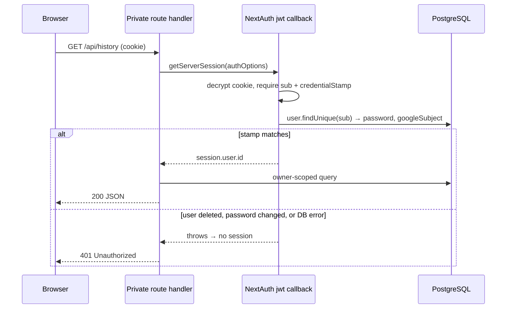
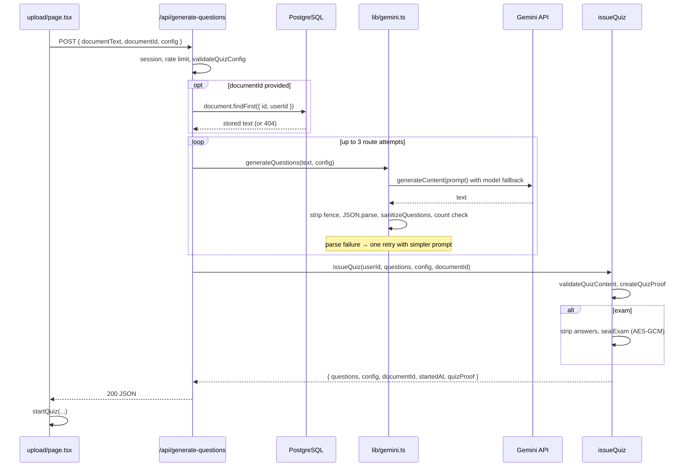
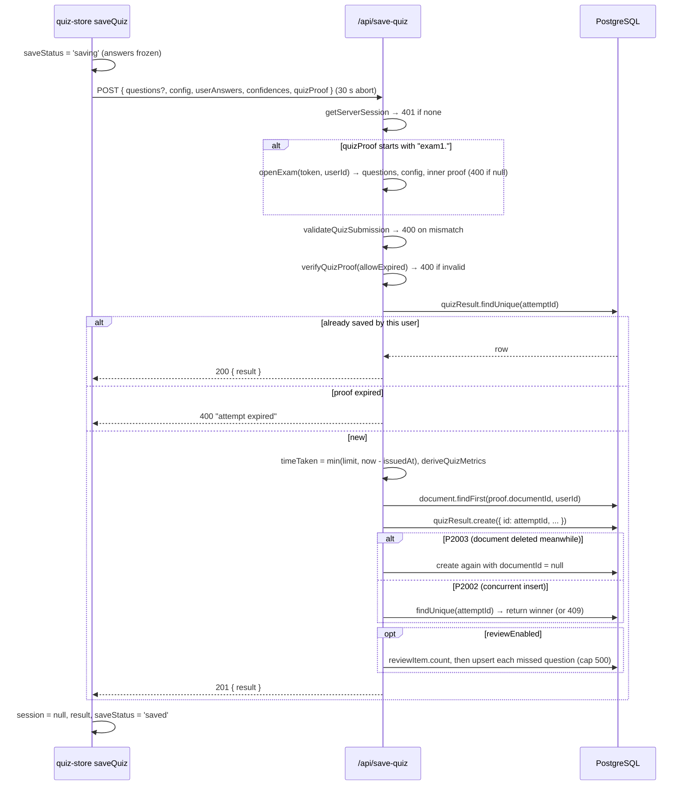
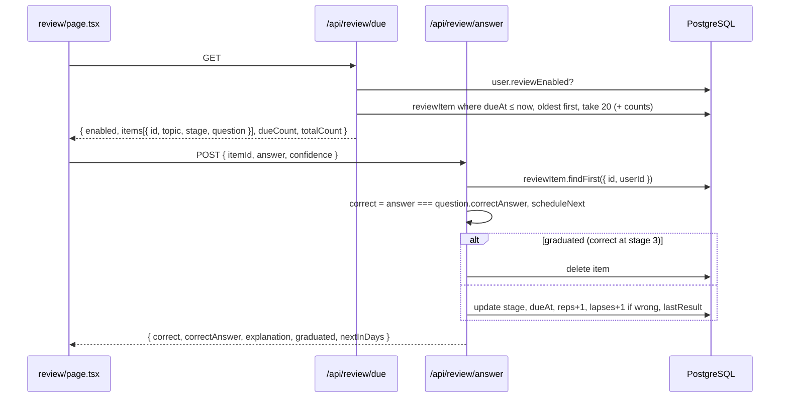
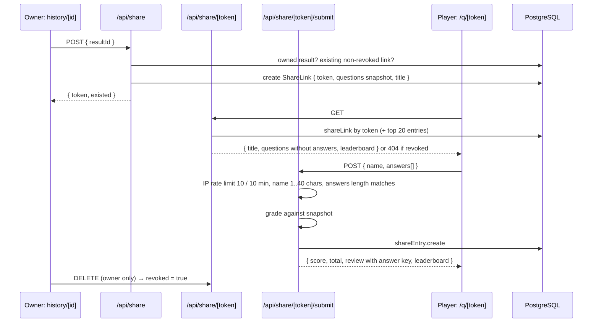
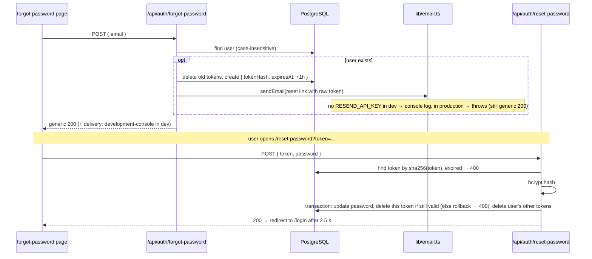

# 05. Core Workflows

[← 04. Codebase Guide](04-CODEBASE-GUIDE.md) | [Index](README.md) | [Next: 06. Data and API →](06-DATA-AND-API.md)

**Purpose:** trace each implemented feature from the user's action to storage and back, including what happens when things fail.
**Prerequisites:** [03. Architecture](03-ARCHITECTURE.md). For exact request and response bodies, keep [06. Data and API](06-DATA-AND-API.md#api-inventory) open.

All flows below come from source inspection. None were exercised against a live database or provider while writing these guides; [10](10-TESTING-AND-TROUBLESHOOTING.md#manual-verification-journeys) gives steps to watch them yourself.

## Contents

1. [Sign up, sign in, and reach protected features](#1-sign-up-sign-in-and-reach-protected-features)
2. [Upload a document and extract text](#2-upload-a-document-and-extract-text)
3. [Generate a quiz](#3-generate-a-quiz)
4. [Take a quiz](#4-take-a-quiz)
5. [Deadlines and auto-submit](#5-deadlines-and-auto-submit)
6. [Submit, grade, and save](#6-submit-grade-and-save)
7. [Refresh recovery and failed saves](#7-refresh-recovery-and-failed-saves)
8. [Results, history, and the dashboard](#8-results-history-and-the-dashboard)
9. [Retake a quiz](#9-retake-a-quiz)
10. [Cram Mode](#10-cram-mode)
11. [Smart Review](#11-smart-review)
12. [Ask the AI](#12-ask-the-ai)
13. [Document library](#13-document-library)
14. [Share a quiz and play it publicly](#14-share-a-quiz-and-play-it-publicly)
15. [Password and account lifecycle](#15-password-and-account-lifecycle)

---

## 1. Sign up, sign in, and reach protected features

| Step | Detail |
|---|---|
| User action | Fill in `/register`, then sign in at `/login`, or click "Continue with Google" |
| Frontend entry | [`app/register/page.tsx`](../app/register/page.tsx) posts `{ name, email, password }` to `/api/register`, then navigates to `/login`. [`app/login/page.tsx`](../app/login/page.tsx) calls `signIn('credentials', { email, password, redirect: false })`, then `router.push('/upload')`. [`GoogleSignInButton`](../components/GoogleSignInButton.tsx) calls `signIn('google', { callbackUrl })`. |
| Validation | Register: per-IP limit 5 per 15 min, `normalizeEmail` (trim, NFKC, lowercase), `isValidEmail`, password length ≥ 8, no existing user with the same email (case-insensitive). |
| Server processing | Register hashes with `bcrypt.hash(password, 10)` and creates the `User`. Sign-in runs `authorize` in [`lib/auth.ts`](../lib/auth.ts): find user, `bcrypt.compare`, return `{ id, email, name, credentialStamp }`. The `jwt` callback stores `sub` and `credentialStamp` in the encrypted cookie. |
| Storage | `User` row; NextAuth's session cookie. NextAuth v4 names it `next-auth.session-token`, with a `__Secure-` prefix on HTTPS origins; `authOptions` does not override the name. Not observed in a running app. |
| Response / UI | Register returns 201. Sign-in sets the cookie; `useSession()` becomes `authenticated`. |
| Failures | Register: 429, 400 (invalid email, short password, existing user), 500. Sign-in: wrong password or OAuth-only account → "Invalid email or password". Google: unverified email, missing subject, or an email that already belongs to a password account without a linked Google subject → sign-in refused (`canUseGoogleIdentity`). |

**Protected access afterwards.** Every request to a private API runs `getServerSession(authOptions)`, which runs the `jwt` callback, which re-reads the user and compares the credential stamp. Pages additionally redirect to `/login` when `useSession()` reports `unauthenticated`.

## 2. Upload a document and extract text

| Step | Detail |
|---|---|
| User action | Drop a file on `/upload`, on the hero pill at `/`, or on the dashboard pill |
| Frontend entry | [`FileUpload`](../components/FileUpload.tsx) (react-dropzone, `maxSize` 10 MB, one file) or [`useFileUpload`](../hooks/useFileUpload.ts). `validateFile` runs first in the browser. On the landing page, `requireAuth` sends signed-out users to `/login` instead. |
| Request | `POST /api/analyze-document`, `multipart/form-data` with field `file` |
| Validation | Session required; limit 20 per 10 min per user; `validateFile` (≤ 10 MB, `.pdf`/`.docx` extension **and** matching MIME); `validateFileSignature` (magic bytes) |
| Processing | `parseDocument` → `parsePDF` (≤ 500 pages) or `parseDOCX` (`assertSafeDocxArchive`, then mammoth). Extracted text must be ≤ 2,000,000 characters. |
| Storage | Best effort: create a `Document` with the filename (minus extension) as title, then delete any of the user's documents beyond the newest 20. Failure here is logged and ignored; `documentId` is then `null`. |
| Response / UI | `{ success, documentId, text, wordCount, pageCount }`. The hook calls `setDocumentText(text)` and `setDocumentId(documentId)`, and the page shows the configure step. |
| Failures | 401, 429, 400 for validation or document problems (detected by message substrings such as "failed to parse pdf"), 500 otherwise. The UI shows the error message in the drop zone or pill. |

Edge case: a scanned PDF with no text layer extracts little or nothing. Upload still succeeds; generation then fails with "Quiz source is empty" if the text is blank after trimming, or with a low-quality quiz if there is a little text.

## 3. Generate a quiz

| Step | Detail |
|---|---|
| User action | Choose mode, question count, time limit, difficulty; click **Start Quiz** |
| Frontend entry | [`QuizConfig`](../components/QuizConfig.tsx) calls `onStart({ numQuestions, timeLimit, difficulty, mode })`, handled by `handleStartQuiz` in [`app/upload/page.tsx`](../app/upload/page.tsx). A 125-second `AbortController` guards the request. [`GeneratingStatus`](../app/upload/page.tsx) changes its message at 7 and 14 seconds. |
| Request | `POST /api/generate-questions` with `{ documentText, documentId, config }` |
| Validation | Session; limit 10 per 10 min per user; source present; if `documentId` is given it must belong to the user (404 otherwise) and its stored text replaces `documentText`; `validateQuizConfig` |
| Processing | Up to 3 route-level attempts of `generateQuestions` with 1 s then 2 s back-off. Inside, see [07](07-AI-GENERATION.md#the-pipeline-at-a-glance). Then `issueQuiz(userId, questions, config, documentId)`. |
| Providers | Gemini receives up to 50,000 characters of the source text in the prompt |
| Response / UI | Practice: full questions, canonical `config`, `documentId`, `startedAt`, `quizProof`, `count`. Exam: questions without answers or explanations and an `exam1.` token as `quizProof`. The page calls `startQuiz(...)` with the server's `startedAt`. |
| Failures | 400 invalid input; 404 document not found; 422 if issuance validation fails (for example an exam over 1.5 MB); 500 for generation errors (in development the response also includes a stack trace). The UI maps messages containing 503/overloaded, 429, or 401 to friendlier text. |

## 4. Take a quiz

### Practice

1. [`QuizInterface`](../components/QuizInterface.tsx) fetches `/api/account` once to learn `confidenceEnabled`. If the fetch fails, confidence buttons are hidden.
2. The user selects an option, optionally Sure/Unsure, and clicks **Submit Answer**. `submitAnswer(answer, confidence)` writes into the session. It returns `false` if paused, saving, or out of time.
3. [`FeedbackModal`](../components/FeedbackModal.tsx) opens with the correct answer and explanation (both already in the browser). The option buttons turn green or red.
4. **Next Question** calls `nextQuestion()`. On the last question, or if time is up, it calls `onComplete`, which is `saveQuiz()`.

**Pause.** **Pause practice** sets `pausedAt`. The question timer freezes, but the hard deadline keeps running; the paused view shows "Attempt expires in". **Resume** moves `startTime` forward by the paused duration. The saved `timeTaken` is computed by the server from issue time, so it includes breaks, as the UI states.

### Exam

1. [`ExamInterface`](../components/ExamInterface.tsx) shows numbered navigation, previous/next, and options. Selecting an option calls `submitAnswer(option)` and can be changed any time.
2. No correctness, explanation, or confidence is shown or collected.
3. **Finish exam** asks for confirmation with the count of unanswered questions, then calls `onComplete`.

Failure modes: all actions become no-ops once `getRemainingTime()` is 0; the next click triggers completion instead. See [`tests/quiz-lifecycle.test.ts`](../tests/quiz-lifecycle.test.ts) and [`tests/quiz-interface.test.tsx`](../tests/quiz-interface.test.tsx).

## 5. Deadlines and auto-submit

| Element | Rule | Code |
|---|---|---|
| Question deadline | `startTime + timeLimit` (seconds) | `attemptDeadline` in [`lib/countdown.ts`](../lib/countdown.ts) |
| Hard deadline | `startedAt + limit + 14 min` (practice) or `+ 0` (exam) | `startQuiz` in [`store/quiz-store.ts`](../store/quiz-store.ts) |
| Effective deadline | While paused: the hard deadline. Otherwise: the earlier of the two. | `attemptDeadline` |
| Server expiry | `issuedAt + limit + 15 min` (practice) or `+ 30 s` (exam) | `saveGrace` in [`lib/quiz-proof.ts`](../lib/quiz-proof.ts) |

[`AttemptDeadline`](../components/AttemptDeadline.tsx) is mounted for every authenticated page by [`AttemptRecovery`](../components/AttemptRecovery.tsx). It calls `watchAttemptDeadline(userId, [window, document])`, which:

1. Subscribes to the store and keeps one `subscribeCountdown` timer armed for the current proof and deadline.
2. When the deadline passes, calls `saveQuiz()` if the attempt belongs to this user and `saveStatus === 'idle'`.
3. Re-checks on `focus`, `pageshow`, and `visibilitychange` to catch up after throttling or sleep.

On pages other than `/upload`, `AttemptDeadline` also renders a banner ("Your quiz timer is still running…", "Saving…", "needs attention", "saved") with a link back to `/upload`.

Boundary: if no QuizForge tab is open at the deadline, nothing submits. The next time the user opens the app in the same tab, recovery restores the overdue attempt and the watcher submits it immediately, provided the server still accepts the proof.

## 6. Submit, grade, and save

Key points:

- The server ignores any client-sent score. In exam mode it also ignores client-sent questions and config: the decrypted content overwrites them.
- `timeTaken` comes from the server clock and is capped at the time limit.
- Review enqueueing is best effort and wrapped in `try/catch`. A failure there does not fail the save.
- Client side, if the response arrives after the user started a different attempt (`get().session !== session`), it is ignored.

Covered by [`tests/save-quiz-integrity.test.ts`](../tests/save-quiz-integrity.test.ts).

## 7. Refresh recovery and failed saves

1. Whenever `session`, `saveStatus`, or `documentId` changes, `connectAttemptRecovery` writes `{ version: 1, ownerId, session, documentId, saveStatus }` to `sessionStorage['quizforge-attempt-v1']`. With no session it removes the key. Document text and results are never written.
2. On page load, once NextAuth reports the user, `parseAttemptDraft` validates the draft (owner, version, sizes, counts, answer values, timing fields, exam rules). Invalid drafts are deleted and a `recoveryError` message is shown.
3. A draft saved during `saving` is restored as `failed` with the message "The previous save was interrupted. Retry to retrieve or save your result." The user clicks **Retry save**, which calls `saveQuiz(true)` with the identical payload. Because saves are idempotent, a save that actually reached the server returns the stored result.
4. If storage writes fail (private mode, quota), the draft is removed and the page shows "Refresh recovery is unavailable in this tab. Keep this page open until your result is saved."
5. Signing out or switching accounts resets the store and clears the draft.

Covered by [`tests/attempt-recovery.test.ts`](../tests/attempt-recovery.test.ts).

## 8. Results, history, and the dashboard

| View | Request | Server work | UI |
|---|---|---|---|
| Results after save | none (uses `result` from the save response) | | [`ResultsDashboard`](../components/ResultsDashboard.tsx): score, accuracy, time, topic chart, weak topics, suggestions |
| `/history` | `GET /api/history` then `?cursor=<lastId>` | 20 summaries per page (21 fetched to detect more); cursor must be one of the user's results | [`QuizHistory`](../components/QuizHistory.tsx) with "load more" and delete |
| `/history/<id>` | `GET /api/history/<id>` | Owner check, `deserializeQuizResult` | Per-question review, retake, share |
| `/dashboard` | `GET /api/history?view=dashboard` | Reads all of the user's results in batches of 100 (snapshot `createdAt ≤ now`) into `createHistoryAnalytics`; returns 6 recent items and the analytics | Stat cards, charts, calibration, review and cram panels |
| Delete | `DELETE /api/history/<id>` | Owner check, delete | Refetch list |

Failures: history errors show a retry button. A stale cursor (the row was deleted) returns 400 "History changed. Reload the list to continue."

## 9. Retake a quiz

From `/history/<id>`, **Retake** posts to `/api/history/<id>`. The server loads the owned result, re-validates it with `validateQuizContent` (older results that fail current rules return 422 "This older quiz cannot be retaken…"), shuffles question order and options with `shuffleQuestions`, and issues a new proof with `issueQuiz`. The original mode is preserved, so an exam retake is again an encrypted exam. The page calls `startQuiz` and navigates to `/upload?step=quiz`.

## 10. Cram Mode

From the dashboard, choose 10, 20, or 30 and start. `GET /api/cram?count=N` (limit 10 per 10 min):

1. Load the 50 most recent results.
2. For each valid question, update per-topic correct/total and add it to a per-topic pool (≤ 100 each). Count wrong answers per `questionHash`.
3. Pick the most-missed questions first. Then fill from topics with at least 2 attempts and under 60% accuracy, weakest first, skipping duplicates.
4. Fewer than 5 picks → 400 "Not enough weak spots found yet". No results → 400 "Take a few quizzes first".
5. Shuffle, build `{ numQuestions, timeLimit: max(5, count) minutes, difficulty: 'mixed', cram: true }`, and `issueQuiz` with no document.

Cram quizzes are always practice mode; `validateQuizConfig` rejects exam plus cram.

## 11. Smart Review

Items are created by the save route (flow 6) for every missed question when `reviewEnabled` is true: new items start at stage 0 due in 12 h (wrong and "sure") or 24 h; existing items with the same `questionHash` are reset to stage 0. Turning review off in Settings stops new items and makes `/api/review/due` return `enabled: false`; existing items remain in the database.

Note: the due payload contains each question's full JSON, including `correctAnswer`. See [08](08-AUTH-SECURITY-AND-RELIABILITY.md#known-limitations).

## 12. Ask the AI

In the practice feedback modal, the user types a question (3 to 500 characters). [`FeedbackModal`](../components/FeedbackModal.tsx) posts `{ question, userAnswer, query, documentId }` to `/api/explain` (limit 10 per 10 min per user). If `documentId` belongs to the user, `relevantExcerpt` picks up to 3,000 characters of the paragraphs that share the most words longer than 3 letters with the question. `explainAnswer` sends a tutor prompt to Gemini and returns `{ explanation, grounded }`. Nothing is stored. Details in [07](07-AI-GENERATION.md#ask-the-ai-explanations).

## 13. Document library

| Action | Request | Server | UI |
|---|---|---|---|
| List | `GET /api/documents` | Owner's documents, newest first, with `quizCount` | [`app/documents/page.tsx`](../app/documents/page.tsx) |
| New quiz | `GET /api/documents/<id>` | Full row including text | `setDocumentText`, `setDocumentId`, go to configure step |
| Rename | `PATCH /api/documents/<id>` `{ title }` | 1 to 120 characters, `updateMany` scoped to owner | Inline edit |
| Delete | `DELETE /api/documents/<id>` | `deleteMany` scoped to owner; results keep existing with `documentId = null` | Remove from list |

## 14. Share a quiz and play it publicly

The share link snapshots the questions at creation time, so later deletion of the source result does not change the shared quiz. Revoked links return 404 but keep their entries.

## 15. Password and account lifecycle

### Change password (signed in)
[`app/settings/page.tsx`](../app/settings/page.tsx) checks that the two new passwords match, then posts `{ currentPassword, newPassword }` to `/api/account/password` (limit 5 per 15 min per user). The server verifies the current password, hashes the new one, and in a transaction writes it only if the stored hash is unchanged, then deletes all reset tokens. 409 if credentials changed concurrently. The page then calls `signOut`, because the new hash has already revoked the session.

### Forgot and reset password

Every password write changes the bcrypt hash, so every existing session for that user fails its next stamp check.

### Delete account
Settings requires typing `DELETE`; the client sends `{ confirm: 'DELETE' }` to `DELETE /api/account`. The server deletes the `User`; documents, results, review items, share links (and their entries), and reset tokens cascade. The page then signs out. Data already sent to Gemini or Resend is outside QuizForge's control.

### Sign out and account switch
`signOut` clears the NextAuth cookie. `AttemptRecovery` sees `userId` become `null`, resets the store, and removes the draft. If another user signs in in the same tab, the store is reset before their pages render.

---

[← 04. Codebase Guide](04-CODEBASE-GUIDE.md) | [Index](README.md) | [Next: 06. Data and API →](06-DATA-AND-API.md)
