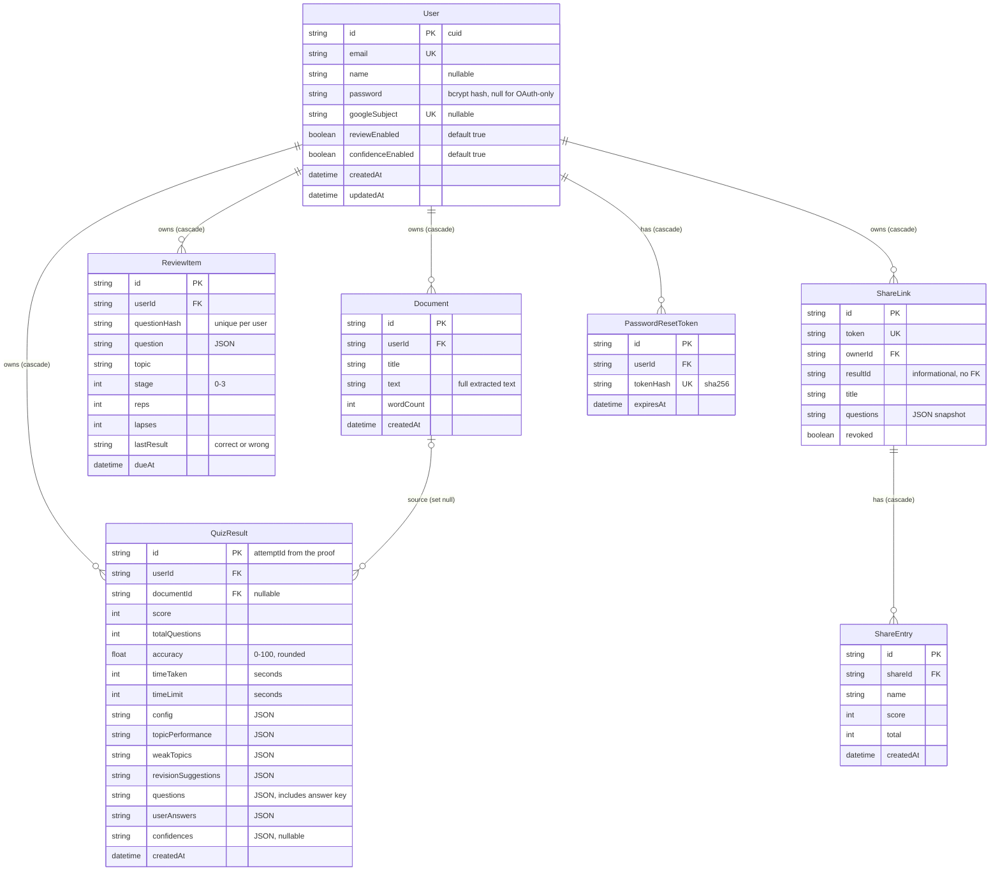

# 06. Data and API

[← 05. Core Workflows](05-CORE-WORKFLOWS.md) | [Index](README.md) | [Next: 07. AI Generation →](07-AI-GENERATION.md)

**Purpose:** a reference for what QuizForge stores, where, who may access it, and every HTTP endpoint's contract.
**Prerequisites:** [02, concept 6](02-CONCEPTS.md#6-database-models-relations-and-json-columns) for Prisma basics.

Source of truth: [`prisma/schema.prisma`](../prisma/schema.prisma) and the handlers under [`app/api/`](../app/api/). All examples use fictional data.

## Entity-relationship diagram



## Models and meaningful constraints

| Model | Constraints and indexes | Notes |
|---|---|---|
| `User` | `email` unique; `googleSubject` unique | Emails are stored normalized by register and Google sign-in, and also looked up case-insensitively (`mode: 'insensitive'`). The unique index itself is case-sensitive. |
| `Document` | index `userId` | At most 20 per user, enforced by the upload route after each insert, not by the database |
| `QuizResult` | `id` is supplied by the server (the proof's `attemptId`), not generated | The primary-key collision is what makes saves idempotent. No index on `userId` is declared. |
| `ReviewItem` | unique `(userId, questionHash)`; index `(userId, dueAt)` | Cap of 500 per user enforced in the save route |
| `ShareLink` | `token` unique; index `ownerId` | `resultId` is a plain string, so deleting the result does not affect the link |
| `ShareEntry` | index `(shareId, score)` | Leaderboard reads order by score then time |
| `PasswordResetToken` | `tokenHash` unique; index `userId` | Raw token is never stored |

The generator enables Prisma's `strictUndefinedChecks` preview feature, which makes passing `undefined` in a query an error instead of "ignore this field".

### JSON column shapes

```jsonc
// QuizResult.config (practice)            // QuizResult.config (exam)
{ "numQuestions": 10, "timeLimit": 15,      { "numQuestions": 10, "timeLimit": 15,
  "difficulty": "medium" }                    "difficulty": "hard", "mode": "exam" }

// QuizResult.topicPerformance
[{ "topic": "Cell Membranes", "correct": 3, "total": 4, "percentage": 75 }]

// QuizResult.questions (one element)
{ "id": "q1", "question": "Which organelle produces ATP?",
  "options": { "a": "Ribosome", "b": "Mitochondrion", "c": "Golgi body", "d": "Lysosome" },
  "correctAnswer": "b", "explanation": "Mitochondria carry out cellular respiration.",
  "topic": "Organelles", "difficulty": "easy" }

// QuizResult.userAnswers / confidences
["b", null, "c"]        ["sure", null, "unsure"]
```

## Persistent, transient, and browser-local data

| Category | Data | Where |
|---|---|---|
| **Persistent (server)** | All models above | PostgreSQL |
| **Session** | `sub` (user id), `credentialStamp`, plus NextAuth's standard name/email/picture claims | Encrypted JWT cookie |
| **Client-held, server-signed** | `quizProof` (HMAC) or `exam1.` token (encrypted) | Browser memory and recovery draft |
| **Browser-local** | Recovery draft (`quizforge-attempt-v1`) | `sessionStorage` |
| | Banner dismissal (`features-banner-dismissed`) | `localStorage` |
| **Transient (server)** | Rate-limit counters | Process memory |
| | Uploaded file bytes, Gemini prompts and responses | Request memory only; never written to disk by QuizForge |
| **Logs** | `console.error` / `console.log` output, including error objects | Host's log stream |

## Ownership and access rules

| Resource | Who can read | Who can change | Enforcement |
|---|---|---|---|
| User profile | Self | Self | `session.user.id` |
| Document | Owner | Owner | `findFirst/updateMany/deleteMany` with `userId` |
| QuizResult | Owner | Owner (delete only) | Fetch then compare `userId` → 404 |
| ReviewItem | Owner | Owner via review answers; save route | `findFirst({ id, userId })` |
| ShareLink payload (no answers) | Anyone with the token, unless revoked | Owner (revoke) | Token lookup; `updateMany({ token, ownerId })` |
| ShareEntry | Anyone with the token (top 20) | Anyone with the token can add one | Per-IP rate limit only |
| PasswordResetToken | Nobody directly | Holder of the raw token (once, within 1 h) | Hash lookup and transactional consume |

## Lifecycle, update, and deletion behavior

| Event | Effect |
|---|---|
| Upload | New `Document`; documents beyond the newest 20 deleted (their results keep existing with `documentId = null`) |
| Save quiz | New `QuizResult`; for each missed question, upsert a `ReviewItem` reset to stage 0 (if enabled and under the cap) |
| Review answer | Update stage, due date, counters; delete when graduated |
| Delete result | `QuizResult` removed. Review items and share links created from it remain. |
| Delete document | `Document` removed; results keep their data |
| Revoke share | `revoked = true`; entries kept |
| Password change or reset | `User.password` replaced; all of that user's reset tokens deleted; all sessions revoked |
| Disable Smart Review | No new items; existing items kept but hidden |
| Delete account | `User` and every owned row cascade-deleted |

Nothing expires automatically. Expired reset tokens remain until the user requests another reset or the account is deleted.

---

## API inventory

Conventions:

- All bodies are JSON unless noted. Error bodies use `{ "error": string }` for `analyze-document` and `generate-questions`, and `{ "message": string }` everywhere else.
- **Auth** column: *Session* = requires a valid NextAuth session (401 otherwise). *Public* = no session.
- **Limit** = `checkRateLimit` per server instance.
- Every handler returns 500 with a generic message for unexpected errors.

| Method & path | Purpose | Auth | Limit |
|---|---|---|---|
| `GET/POST /api/auth/*` | NextAuth endpoints (sign-in, callback, session, csrf, providers, sign-out) | Public | none in code |
| `POST /api/register` | Create a credentials account | Public | 5 / 15 min / IP |
| `POST /api/auth/forgot-password` | Request a reset link | Public | 3 / 15 min / IP |
| `POST /api/auth/reset-password` | Set a password with a reset token | Public (token) | 5 / 15 min / IP |
| `GET /api/account` | Profile and preferences | Session | |
| `PATCH /api/account` | Update name or preferences | Session | |
| `DELETE /api/account` | Delete account | Session | |
| `POST /api/account/password` | Change password | Session | 5 / 15 min / user |
| `POST /api/analyze-document` | Upload and extract text | Session | 20 / 10 min / user |
| `POST /api/generate-questions` | Generate and issue a quiz | Session | 10 / 10 min / user |
| `POST /api/save-quiz` | Verify, grade, save | Session | |
| `GET /api/history` | History page or dashboard analytics | Session | |
| `GET /api/history/[id]` | One result | Session, owner | |
| `POST /api/history/[id]` | Issue a retake | Session, owner | |
| `DELETE /api/history/[id]` | Delete a result | Session, owner | |
| `GET /api/cram` | Issue a cram quiz | Session | 10 / 10 min / user |
| `GET /api/review/due` | Due review items | Session | |
| `POST /api/review/answer` | Grade one review item | Session, owner | 60 / 10 min / user |
| `POST /api/explain` | AI follow-up explanation | Session | 10 / 10 min / user |
| `GET /api/documents` | List library | Session | |
| `GET /api/documents/[id]` | Document with text | Session, owner | |
| `PATCH /api/documents/[id]` | Rename | Session, owner | |
| `DELETE /api/documents/[id]` | Delete | Session, owner | |
| `POST /api/share` | Create or reuse a share link | Session, owner of result | 10 / 10 min / user |
| `GET /api/share/[token]` | Public quiz payload and leaderboard | Public | |
| `DELETE /api/share/[token]` | Revoke | Session, owner | |
| `POST /api/share/[token]/submit` | Submit answers anonymously | Public | 10 / 10 min / IP |

"Internal use" note: every endpoint is designed for QuizForge's own pages. None is versioned or documented as a public API, and there is no API key mechanism. Treat them as internal contracts that may change with the UI.

### Accounts and authentication

**`POST /api/register`**
```json
// Request
{ "name": "Asha Learner", "email": "learner@example.com", "password": "correct-horse-1" }
// 201
{ "message": "User registered successfully", "user": { "id": "clx0example", "email": "learner@example.com", "name": "Asha Learner" } }
```
Errors: 400 missing fields, invalid email, password under 8 characters, or "User with this email already exists"; 429.

**`POST /api/auth/forgot-password`** `{ "email": "learner@example.com" }` → always 200 `{ "message": "If an account exists for that email, a reset link has been sent." }`, plus `"delivery": "development-console"` when not in production and `RESEND_API_KEY` is unset. 400 only if `email` is missing or not a string; 429.

**`POST /api/auth/reset-password`** `{ "token": "<64 hex chars>", "password": "new-password-2" }` → 200 `{ "message": "Password updated - you can now sign in." }`. 400 invalid, expired, or already-used token, or short password; 429.

**`GET /api/account`** → `{ id, name, email, hasPassword, reviewEnabled, confidenceEnabled, createdAt }`. 404 if the user row is gone.

**`PATCH /api/account`** with any of `{ "name": "1-80 chars", "reviewEnabled": true, "confidenceEnabled": false }` → `{ "message": "Profile updated" }`. 400 on a wrong type or "Nothing to update".

**`DELETE /api/account`** `{ "confirm": "DELETE" }` → `{ "message": "Account deleted" }`. 400 without the confirmation.

**`POST /api/account/password`** `{ "currentPassword": "...", "newPassword": "8+ chars" }` → 200 `{ "message": "Password updated. Sign in again with your new password." }`. 400 short password, Google-only account, or wrong current password; 409 concurrent credential change; 429.

### Documents and generation

**`POST /api/analyze-document`** (`multipart/form-data`, field `file`)
```json
// 200
{ "success": true, "documentId": "clx0doc1", "text": "Cell Biology Notes ...", "wordCount": 1843, "pageCount": 6 }
```
`pageCount` is present for PDFs only. `documentId` is `null` if the library save failed. Errors: 400 no file, invalid type/size/signature, or unparseable/oversized document; 429.

**`POST /api/generate-questions`**
```json
// Request
{ "documentId": "clx0doc1", "documentText": "…", "config": { "numQuestions": 10, "timeLimit": 15, "difficulty": "medium", "mode": "practice" } }
// 200 (practice)
{ "success": true, "questions": [ /* full Question objects */ ], "config": { "numQuestions": 10, "timeLimit": 15, "difficulty": "medium" },
  "documentId": "clx0doc1", "startedAt": 1791000000000, "quizProof": "<base64url-claims>.<base64url-hmac>", "count": 10 }
// 200 (exam): questions omit correctAnswer and explanation; quizProof starts with "exam1."
```
Errors: 400 missing source or config, invalid `documentId` or config, empty source; 404 document not owned; 422 issuance rejected; 429; 500 generation failure (with `details` stack in development).

**`GET /api/documents`** → `[{ id, title, wordCount, createdAt, quizCount }]`.
**`GET /api/documents/[id]`** → the full `Document` row including `text` and `userId`. 404 if not owned.
**`PATCH /api/documents/[id]`** `{ "title": "Cell Biology (Unit 2)" }` → `{ "message": "Renamed" }`. 400 empty or over 120 characters.
**`DELETE /api/documents/[id]`** → `{ "message": "Deleted" }`.

### Attempts and results

**`POST /api/save-quiz`**
```json
// Request (practice)
{ "questions": [ … ], "config": { "numQuestions": 10, "timeLimit": 15, "difficulty": "medium" },
  "userAnswers": ["b", "a", null, …], "confidences": ["sure", null, "unsure", …], "quizProof": "<payload>.<signature>" }
// Request (exam): omit questions; quizProof is the "exam1." token
// 201 (new) or 200 (already saved)
{ "message": "Quiz result saved successfully",
  "result": { "id": "<attemptId>", "score": 7, "totalQuestions": 10, "accuracy": 70, "timeTaken": 512, "timeLimit": 900,
              "topicPerformance": [ … ], "weakTopics": ["Organelles"], "revisionSuggestions": [ "…" ],
              "questions": [ … ], "userAnswers": [ … ], "confidences": [ … ], "config": { … },
              "documentId": "clx0doc1", "userId": "clx0example", "createdAt": "2026-10-01T10:15:00.000Z", "timestamp": 1791000512000 } }
```
Errors: 400 "Exam verification failed", validation messages, "Quiz verification failed", "This attempt expired before it was saved. Start a new quiz."; 409 "Quiz result has already been saved" (another user's id collision, practically impossible); 401.

**`GET /api/history`**
- Default: `{ "items": HistorySummary[], "nextCursor": "<id>" | null }`. `HistorySummary` = `{ id, createdAt, timestamp, accuracy, score, totalQuestions, timeTaken, config, weakTopics }`. Query `cursor=<id>` continues. 400 for a cursor over 200 characters or not owned.
- `?view=dashboard`: `{ items: (up to 6), nextCursor: null, analytics: { totalQuizzes, avgScore, topScore, totalQuestions, totalCorrect, avgTime, streak, confidentlyWrong, confidenceRated, performanceData, topicAggregated, calibrationTopics } }`.

**`GET /api/history/[id]`** → the deserialized `QuizResult`. **`POST /api/history/[id]`** → same shape as generate-questions' issued quiz (without `success` and `count`); 422 for an old result that fails validation. **`DELETE /api/history/[id]`** → `{ "message": "Quiz deleted successfully" }`.

**`GET /api/cram?count=10|20|30`** → issued quiz (other counts fall back to 10). 400 with guidance when there is no history or fewer than 5 candidates.

### Review

**`GET /api/review/due`** → `{ "enabled": true, "items": [{ "id": "clx0rev1", "topic": "Organelles", "stage": 1, "question": { /* full Question incl. correctAnswer */ } }], "dueCount": 4, "totalCount": 12 }` or `{ "enabled": false, "items": [], "dueCount": 0, "totalCount": 0 }`.

**`POST /api/review/answer`** `{ "itemId": "clx0rev1", "answer": "b", "confidence": "sure" }` → `{ "correct": true, "correctAnswer": "b", "explanation": "…", "graduated": false, "nextInDays": 7 }`. 400 missing item or invalid answer; 404 not owned; 429.

### AI explanation

**`POST /api/explain`**
```json
// Request
{ "question": { /* Question */ }, "userAnswer": "c", "query": "Why isn't the Golgi body correct?", "documentId": "clx0doc1" }
// 200
{ "explanation": "Your notes describe the Golgi body as packaging proteins …", "grounded": true }
```
400 invalid question payload or query outside 3 to 500 characters; 429; 500 provider error (message passed through).

### Sharing

**`POST /api/share`** `{ "resultId": "<id>" }` → 201 `{ "token": "Xk3p9QmZr2Ab", "existed": false }` or 200 with `existed: true`. 400 missing id; 404 not owned; 429.

**`GET /api/share/[token]`** → `{ "title": "Quiz: Cell Biology Notes", "questionCount": 10, "questions": [{ id, question, options, topic }], "leaderboard": [{ name, score, total, at }] }`. 404 unknown or revoked.

**`DELETE /api/share/[token]`** → `{ "message": "Link revoked" }`. 404 if not the owner's link.

**`POST /api/share/[token]/submit`** `{ "name": "Ravi", "answers": ["b", null, "a", …] }` → `{ score, total, review: [{ question, yourAnswer, correctAnswer, options, explanation, correct }], leaderboard }`. 400 bad name (1 to 40 characters) or answer count; 404; 429.

---

[← 05. Core Workflows](05-CORE-WORKFLOWS.md) | [Index](README.md) | [Next: 07. AI Generation →](07-AI-GENERATION.md)
