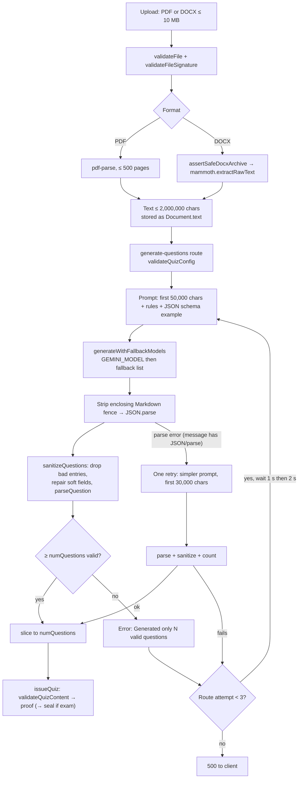

# 07. AI Generation

[← 06. Data and API](06-DATA-AND-API.md) | [Index](README.md) | [Next: 08. Auth, Security, and Reliability →](08-AUTH-SECURITY-AND-RELIABILITY.md)

**Purpose:** explain exactly how a document becomes quiz questions, what is checked along the way, what is not, and how to measure changes.
**Prerequisites:** [02, concepts 7 to 9](02-CONCEPTS.md#7-upload-validation-and-text-extraction). Flow context: [05, flows 2 and 3](05-CORE-WORKFLOWS.md#2-upload-a-document-and-extract-text).

Main files: [`lib/document-parser.ts`](../lib/document-parser.ts), [`lib/gemini.ts`](../lib/gemini.ts), [`app/api/generate-questions/route.ts`](../app/api/generate-questions/route.ts), [`lib/quiz-submission.ts`](../lib/quiz-submission.ts), [`lib/quiz-issuance.ts`](../lib/quiz-issuance.ts).

**Evidence note.** Everything here comes from source inspection. No live Gemini request was made while writing these guides. The benchmark numbers in the [last section](#local-benchmark-uncommitted) come from a mocked SDK and a local report; they say nothing about real model quality.

## The pipeline at a glance



## 1. Inputs and limits

| Limit | Value | Where |
|---|---|---|
| File types | `.pdf` with `application/pdf`; `.docx` with the Word MIME type. Both extension and MIME must match, and so must the magic bytes. | [`lib/file-validation.ts`](../lib/file-validation.ts) |
| File size | 10 MB (browser and server) | `validateFile`, `FileUpload` `maxSize` |
| PDF pages | 500 (`pdf-parse` is asked to read 501 so an overflow is detectable) | `DOCUMENT_LIMITS.maxPdfPages` |
| DOCX archive | ≤ 5,000 entries, ≤ 25 MB expanded, compression ratio ≤ 100, must contain `word/document.xml` | `assertSafeDocxArchive` |
| Extracted text | ≤ 2,000,000 characters | `assertTextBudget` |
| Text sent in the main prompt | First 50,000 characters, then `... (truncated)` if longer | `generateQuestions` |
| Text sent in the fallback prompt | First 30,000 characters | `generateQuestionsSimple` |
| Questions | 5 to 50 | `QUIZ_LIMITS` |

Not supported: scanned images without a text layer (no OCR), PPTX, TXT, Markdown, URLs, and pasted text through the UI. The generate API itself accepts a raw `documentText` string, which is how the configure step works when the library save failed and `documentId` is `null`.

## 2. Extraction and preprocessing

- **PDF:** `pdf-parse` returns the concatenated text layer. Layout, tables, and images are lost. A corrupted file produces the friendly message "The PDF appears to be corrupted or has an invalid structure…".
- **DOCX:** mammoth's `extractRawText` returns paragraph text. The repository patches mammoth ([`patches/mammoth+1.11.0.patch`](../patches/mammoth+1.11.0.patch)) so its XML parser call matches `@xmldom/xmldom` 0.9, which [`package.json`](../package.json) pins through `overrides`. [`tests/document-parser.test.ts`](../tests/document-parser.test.ts) builds a small DOCX in memory to check that extraction works with the patch.
- **Word count:** `text.split(/\s+/).length`, an approximation used only for display.
- **No cleaning.** There is no de-duplication, header/footer removal, chunking, or language detection. Truncation is a plain `substring`, so it can cut mid-sentence and it always keeps the beginning of the document.

## 3. Prompt construction

`generateQuestions` builds one prompt string. Its parts, in order:

1. Role: "You are an expert educator creating multiple-choice questions (MCQs) from the following study material."
2. `STUDY MATERIAL:` followed by the first 50,000 characters.
3. `REQUIREMENTS:` exactly N questions; the difficulty (or "Mix of easy, medium, and hard questions" for `mixed`); exactly four options a to d; cover different topics; a clear correct answer; a brief explanation; a topic name.
4. `OUTPUT FORMAT (JSON array):` with one complete example object.
5. `IMPORTANT:` return only a JSON array without Markdown; answerable from the material; nothing outside the material; plausible distractors; allowed values for `correctAnswer` and `difficulty`.

The fallback prompt in `generateQuestionsSimple` is a compact one-liner: "Create N multiple-choice questions from this text. Return JSON array only:" followed by 30,000 characters and a one-line format example.

There is no system instruction, no `responseMimeType` or JSON schema option passed to the SDK, no temperature setting, and no few-shot examples beyond the format example. *Proposal:* the Gemini API supports structured-output options that could reduce parsing failures; adopting them would need testing against the SDK version in use.

**Prompt injection.** The document text is inserted verbatim. A document that contains instructions ("ignore the above and…") can influence the model. Validation constrains the *shape* of the output, not its content, so an injected document could produce on-shape but misleading questions. The impact is limited to the uploader's own quiz.

## 4. Expected output format

```json
[
  {
    "id": "q1",
    "question": "Which organelle produces most of a cell's ATP?",
    "options": { "a": "Ribosome", "b": "Mitochondrion", "c": "Golgi body", "d": "Lysosome" },
    "correctAnswer": "b",
    "explanation": "Mitochondria carry out aerobic respiration.",
    "topic": "Organelles",
    "difficulty": "easy"
  }
]
```

This matches the `Question` interface in [`lib/types.ts`](../lib/types.ts).

## 5. Provider and model configuration

| Setting | Source | Default |
|---|---|---|
| API key | `GEMINI_API_KEY` (read on every call; missing key throws "GEMINI_API_KEY is not set in environment variables") | none |
| Preferred model | `GEMINI_MODEL`, trimmed | `gemini-2.5-flash` |
| Fallback list | Hard-coded in `generateWithFallbackModels` | preferred, `gemini-2.5-flash`, `gemini-2.5-flash-latest`, `gemini-1.5-flash`, `gemini-1.5-flash-latest`, `gemini-1.5-pro`, `gemini-1.5-pro-latest` (duplicates removed) |
| SDK | `@google/generative-ai` `^0.21.0`, `getGenerativeModel({ model }).generateContent(prompt)` | |

The fallback moves to the next model **only** when the error looks like "model not found": the message contains `404`, `not found`, or `listmodels` (`isModelNotFoundError`). Any other error, such as a quota (429) or overload (503), is thrown immediately. Whether the older 1.5 model names are still served by Google is outside this repository and unverified.

## 6. Parsing and normalization

### Committed vs working-tree parser

The two versions differ only in how they remove a Markdown code fence before `JSON.parse`.

| | Committed (`32cd140`) | Working tree (uncommitted) |
|---|---|---|
| First attempt | If the text starts with `` ```json ``, strip that prefix and a trailing fence; else if it starts with `` ``` ``, strip the bare fence | Shared `parseQuestionResponse`: match one **enclosing** fence with an optional `json` label, case-insensitive, allowing spaces; otherwise parse the trimmed text as-is |
| Retry (simple prompt) | Remove **every** `` ```json `` and `` ``` `` anywhere in the text | Same `parseQuestionResponse` as the first attempt |
| Effect | An uppercase or spaced label (`` ```JSON ``) fails the first parse. The retry's global removal can also delete fence markers that legitimately appear inside question text, which can empty an option and drop the question. | Fences inside JSON string values are preserved. Prose before JSON, multiple blocks, unclosed fences, and other labels are rejected rather than guessed at. |

The working-tree regex is:

```ts
const fenced = trimmed.match(/^```[ \t]*(?:json)?\s*([\s\S]*?)\s*```$/i);
```

Tests for the new behavior are in the untracked `tests/gemini-response.test.ts`. If that change is committed, this table's right column becomes the current behavior; if it is discarded, the left column remains.

### `sanitizeQuestions`

Input must be a JSON **array**; otherwise it throws "Model did not return a JSON array of questions". For each entry:

| Field | Rule |
|---|---|
| `question` | Required non-empty string, trimmed. Missing → entry dropped. |
| `options.a`–`d` | All four required non-empty strings, trimmed. Any missing → dropped. |
| `correctAnswer` | Trimmed, lower-cased; must be `a`–`d`. Otherwise → dropped. |
| `difficulty` | Lower-cased; if not easy/medium/hard → `medium` |
| `id` | Kept if a non-empty string; else `q<index+1>` |
| `explanation` | Kept if non-empty; else `No explanation provided.` |
| `topic` | Kept if non-empty; else `General` |
| Final check | `parseQuestion` enforces lengths (question 5,000, option 2,000, explanation 10,000, topic 200, id 200). Failure → dropped. |

Then: fewer valid questions than requested → throw `Generated only N valid questions, expected M`. More → keep the first M.

Not checked: duplicate questions, duplicate ids, duplicate options, whether the marked answer is actually correct, whether `topic` names are consistent across questions, and whether the requested difficulty was honored.

### Issuance validation

`issueQuiz` validates the questions again with `validateQuizContent`, which also checks the count is within 5 to 50 and builds the canonical config. A failure here returns 422 to the client.

## 7. Retry, timeout, and fallback behavior

Three nested layers:

| Layer | Trigger | Behavior |
|---|---|---|
| Model fallback | "Not found"-style error | Try the next model name |
| Simple-prompt retry | `generateQuestions` catches an error whose message contains `JSON` or `parse` (JSON syntax errors, "did not return a JSON array") | One call to `generateQuestionsSimple`. Its errors propagate. The "Generated only N valid questions" error does **not** contain those words, so it skips this retry. |
| Route retry | Any error from `generateQuestions` | Up to 3 attempts total, waiting 1 s then 2 s |

**Worst case.** Without model fallback, one API call can make up to 6 Gemini requests (3 route attempts × 2 prompts). Model fallback multiplies that only for "not found" errors. The per-user rate limit counts API calls, not Gemini requests.

**Timeouts.** The SDK call has no explicit timeout in the code. The route declares `maxDuration = 120`, which hosts such as Vercel use as an execution limit. The browser aborts after 125 seconds and shows "Generation is taking too long…". Aborting in the browser does not cancel work already running on the server.

**Errors to the user.** 500 with `error` set to the final message, for example `Failed to generate questions: Generated only 7 valid questions, expected 10`. The upload page translates messages that mention 503/overloaded, 429, or 401 into friendlier text (`friendlyError`).

## 8. Rejected and partial output

| Model output | Result |
|---|---|
| Valid array with exactly N good questions | Accepted |
| More than N good questions | First N kept |
| Some invalid entries, still ≥ N good | Invalid ones silently dropped |
| Fewer than N good | Whole attempt fails; route retries; eventually 500 |
| Not JSON, or JSON that is not an array | Simple-prompt retry, then route retries |
| Soft fields missing | Defaults applied (see table above) |

QuizForge never returns a shorter quiz than requested. It also never "guesses" a missing answer.

## 9. Data sent to external services

| Call | Data sent to Google | When |
|---|---|---|
| Question generation | Up to 50,000 (or 30,000) characters of the document text, the requested count and difficulty | Each generation attempt |
| Ask the AI | The question, options, correct answer, the user's chosen answer, the original explanation, up to 3,000 characters of document excerpt (if available), and the user's follow-up text | Each explain request |

No user id, email, or name is included in prompts. How Google retains or uses API inputs depends on the account's terms with Google and is outside this repository.

## Grounding, correctness, and answerability

Be precise about what the safeguards do:

- **Grounding** is requested by the prompt ("Do not create questions about information not in the material"). Nothing verifies it. A question can be about general knowledge, or about text beyond the 50,000-character cut that the model never saw.
- **Correctness** of `correctAnswer` is not checked. Validation only confirms it is one of `a`–`d`. A wrong key would be graded as right.
- **Answerability** is not checked. Two options could both be correct.
- **What validation does guarantee:** every issued question has non-empty text, four non-empty options, an answer key in range, bounded field sizes, and the requested count. After issuance, the proof guarantees the browser cannot change any of that.

*Proposals* (not implemented), each with a cost: ask the model to cite a supporting quote and check that it appears in the source (more tokens, false rejections on paraphrase); run a second "verifier" call per quiz (doubles cost and latency); let users flag bad questions (needs a new table and UI).

## Ask the AI explanations

`explainAnswer(question, userAnswer, userQuery, context?)` in [`lib/gemini.ts`](../lib/gemini.ts):

1. [`/api/explain`](../app/api/explain/route.ts) checks the question shape with a local `isQuestion` (strings for question and options, `correctAnswer` in `a`–`d`) and the query length (3 to 500).
2. If a `documentId` owned by the user is supplied, `relevantExcerpt` splits the document on blank lines, drops paragraphs of 40 characters or fewer, scores each by how many of its words appear in the question's set of words longer than 3 letters, and concatenates the best paragraphs until 3,000 characters.
3. The tutor prompt asks for at most 180 words of plain text, to base the answer on the source when provided, to address the misconception implied by a wrong choice, and to say so when it cannot answer from the material.
4. The response text is returned trimmed with `grounded: true` when an excerpt was included.

Limits: the question object comes from the client and is not checked against a stored quiz, and its fields have no length limits in this route. Word-overlap retrieval misses paraphrases. The 180-word limit is a request to the model, not enforced in code.

## Local benchmark (uncommitted)

The working tree contains a benchmark that measures the parser change above. It is **not committed**, and its raw reports live in git-ignored `docs/local/quiz-generation-metric/`. The files are therefore named here without links: `benchmarks/quiz-generation/PROTOCOL.md`, `benchmarks/quiz-generation/cases.ts`, `benchmarks/quiz-generation/corpus.json`, `benchmarks/quiz-generation/measure.bench.ts`, `benchmarks/quiz-generation.config.mts`, and `scripts/benchmark-quiz-generation.mjs`.

**Fixtures.** `corpus.json` holds three synthetic study notes (data structures, networking, databases), each with five hand-written MCQs. Some options deliberately contain literal Markdown fence markers. `cases.ts` applies 18 scenarios to each document: 10 that should produce a quiz (plain JSON, fenced JSON, uppercase or spaced labels, CRLF fences, repairable soft fields, extra or invalid entries, a broken first response followed by a valid one) and 8 that must be rejected (missing answer or option, truncated JSON, wrong root object, oversized topic, empty array, prose-wrapped JSON, non-string question). That gives 54 cases.

**Method.** Each case builds a deterministic DOCX in memory, runs the real `parseDocument`, then the real `generateQuestions`. Only the Gemini SDK is mocked, with a fixed two-response queue. Network entry points (`fetch`, sockets, `http`, `https`) are stubbed to fail. The baseline variant loads the committed `lib/gemini.ts` from Git (`git show 32cd140:lib/gemini.ts`) in memory; the current variant uses the working file. The metric is the number of mocked `generateContent` requests on the 30 answerable cases, plus pass/fail against a fixed oracle (exact expected questions after allowed defaults, and production validation).

**Reported results** (from the local `REPORT.md`, dated 4 October 2026, Windows x64, Node 24.19.0; *not re-run while writing these guides*):

| Measure | Baseline | Working tree |
|---|---:|---:|
| Correct quizzes, out of 30 answerable cases | 18 | 30 |
| Correct rejections, out of 24 | 24 | 24 |
| Mock requests across answerable cases | 42 | 36 |
| Mock requests across all 54 cases | 75 | 69 |

**Reproduce** (requires dependencies from `package-lock.json`; makes no provider requests):

```powershell
node scripts/benchmark-quiz-generation.mjs
```

**Limitations, as the protocol itself states:** the 54 cases are a designed regression matrix, not a sample of real Gemini traffic; mocks say nothing about latency, real model behavior, grounding, or quality; PDF extraction, HTTP routes, auth, the database, and model fallback are outside its scope. The results do not measure cost savings or user success rates.

---

[← 06. Data and API](06-DATA-AND-API.md) | [Index](README.md) | [Next: 08. Auth, Security, and Reliability →](08-AUTH-SECURITY-AND-RELIABILITY.md)
